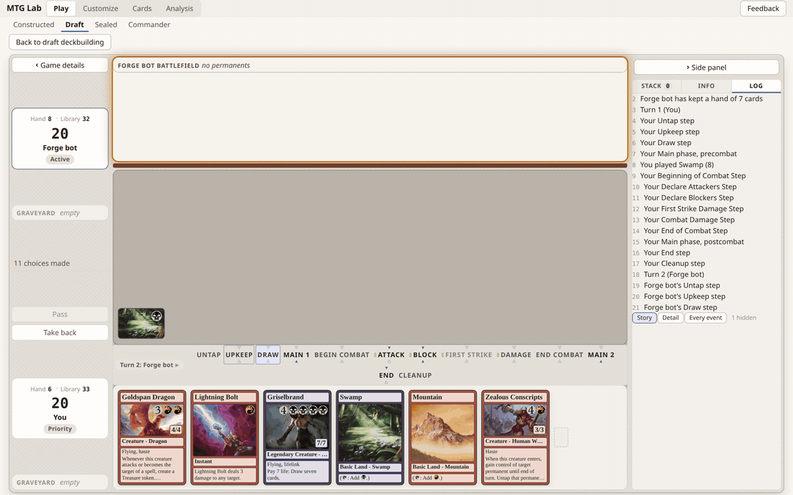
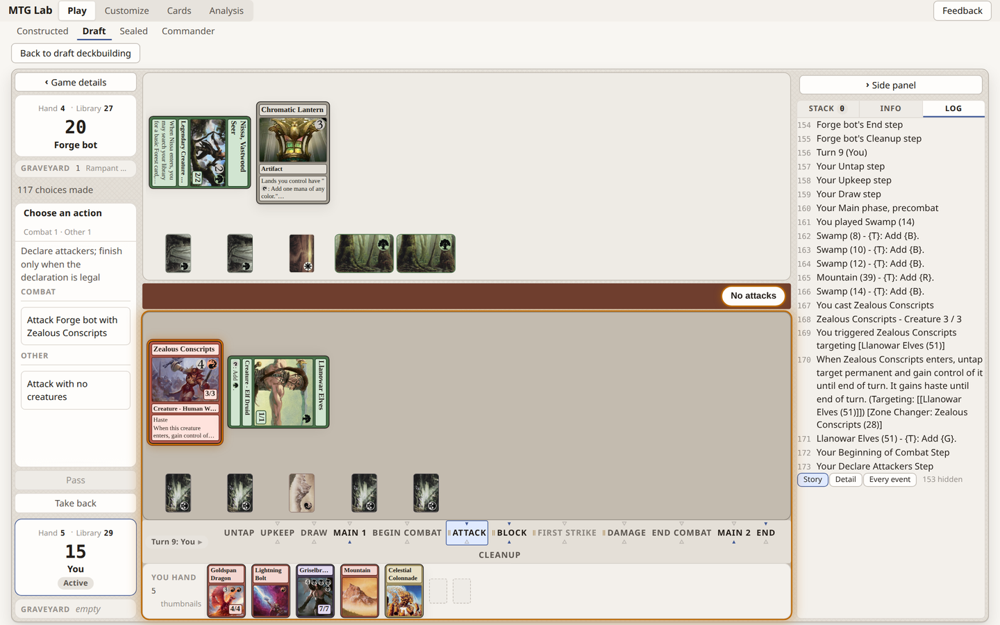
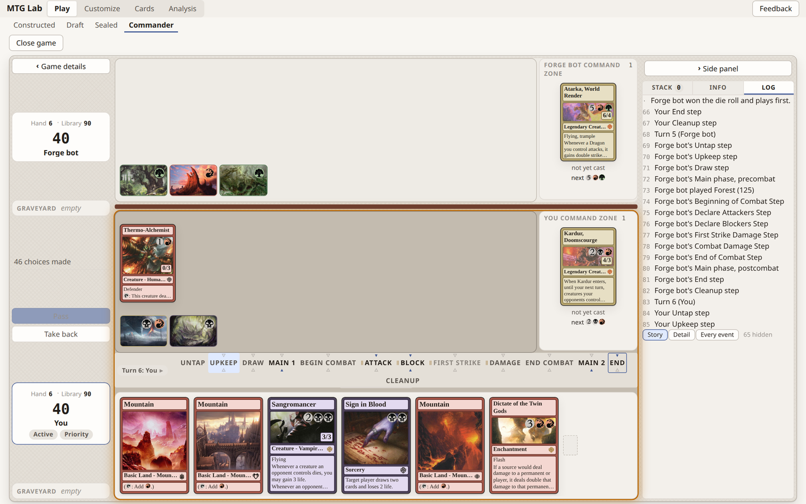
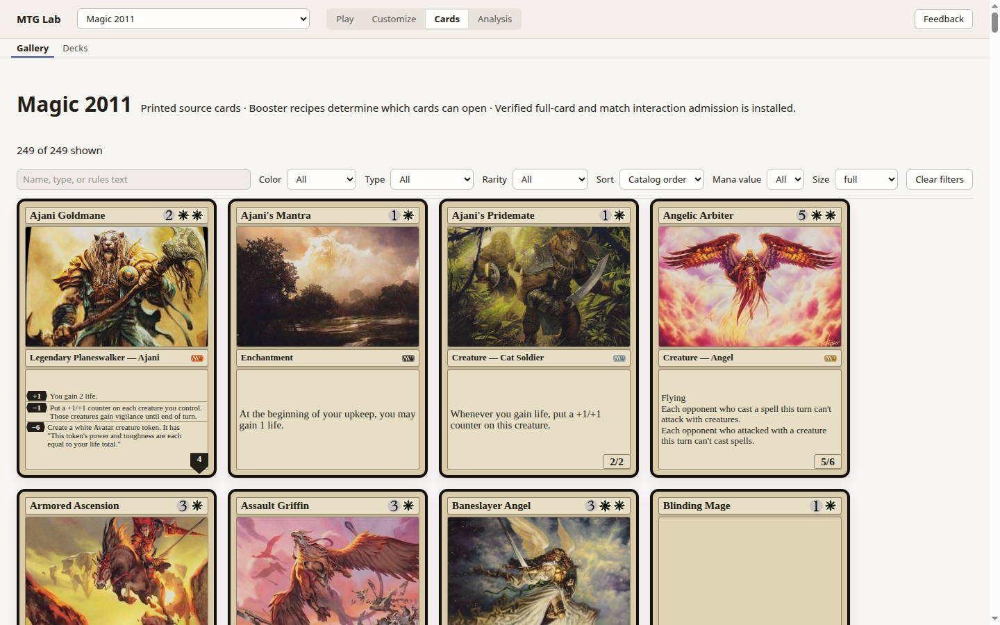

# MTG Lab

Play Magic: The Gathering against bots in your browser, and design your own sets.

> **Work in progress.** This is a research project published as it develops.
> Things change often and some parts are rough. "Known gaps" below lists what
> doesn't work yet.



## Quick start

You need Node 22 or newer.

```bash
git clone https://github.com/sjarmak/mtg.git
cd mtg
npm ci
npm run play        # opens http://localhost:5273
```

With just that you can:

- **Play Tideglass Reach**, the example set, against a bot: sealed, draft or a
  precon game. It runs on this repo's own rules engine. No API key, Forge or
  network needed.
- **Browse, draft and build with about 30 printed formats**: Magic 2010
  through Ixalan, Ravnica, Lorwyn and the MTGO Legacy Cube. Card art loads
  from Scryfall as you browse.
- **Design a set** under Customize. Run `npm run design` instead of
  `npm run play` to get the set designer's checks as you edit.

## Playing real Magic sets against Forge

Games with printed cards (precons, Commander, draft and sealed decks, the
Legacy Cube) are played by [Forge](https://github.com/Card-Forge/forge)'s AI,
which runs as a separate process. You need JDK 21, `unzip`, and on Linux
`xvfb-run`.

```bash
npm run forge:install   # downloads Forge 2.0.14 (about 300 MB) and checks it
npm run play
```

`forge:install` tells you if anything else is missing. In the app, pick a
format under _Magic printed formats_, or use the Draft or Commander tab, and
press _Play Forge match_.

## What it looks like


_Legacy Cube draft: eight seats, bots in the other seven, pick advice on the
right._



_The deck you drafted, played against Forge._



_Commander with the official precons._


_Momir Basic: your deck is all basic lands. Discard a card and pay X to get a
random creature with mana value X._


_The set designer: write a brief (world, mechanics, size) and see the set's
skeleton before any model is called._



_Card gallery for a printed set, filterable by color, type, rarity and mana
value._


_Sealed: open a pool, get a suggested 40-card build, then edit it._

## Making your own set

A set starts from a brief, a short JSON file with the world, up to six
mechanics and the size. The example is
`packages/setgen/briefs/tideglass-reach.json`.

```bash
# Rebuild Tideglass Reach from recorded model answers (no API key, no cost)
npx tsx packages/setgen/src/cli.ts \
  --brief packages/setgen/briefs/tideglass-reach.json --out out/set
```

The generator writes cards in a typed rules language the engine runs, and
refuses cards the engine can't represent instead of approximating them. To
generate a new set with a live model, see `packages/setgen` and
`packages/llm`.

Tideglass Reach has no card art on purpose. It's an example of a custom set,
so its cards show an "art pending" frame.

To check a set's balance:

```bash
npm run slice         # generate, build decks, simulate thousands of games, report
npm run test:balance  # the seeded 10,035-game balance gate
```

## Known gaps

- Momir Basic needs the local card database (`data/store/mtg.sqlite`), built
  from Scryfall bulk data with `@mtg/data`; see `packages/data/README.md`.
  Without it, Momir is hidden.
- With Forge installed, the first launch takes a few minutes while each
  printed format is checked against it.
- Forge games are one-on-one, Commander included. There are no four-player
  pods yet.
- The Commander deck picker shows no win-rate figures in this repo; those
  tables aren't published.
- Only the game table has a phone layout. The other pages are built for
  desktop.
- A clone downloads about 60 MB and takes about 420 MB on disk, mostly card
  catalogs.

## How it's built

TypeScript throughout, no build step in development.

| Package                                  | What it does                                                    |
| ---------------------------------------- | --------------------------------------------------------------- |
| `dsl`                                    | The typed rules language cards are written in                   |
| `kernel`                                 | The rules engine: stack, priority, combat, layers, replacements |
| `deckbuild`, `sim`, `metrics`            | Deck building, bots, mass simulation and balance checks         |
| `llm`, `design-data`, `setgen`           | The set generator and its color pie and skeleton                |
| `data`, `decklab`, `cube`, `image-cache` | Real card data from Scryfall and MTGJSON                        |
| `forge-export`, `draft-export`           | The Forge bridge, and Draftmancer export                        |
| `ui`, `card-render`                      | The browser app and card faces                                  |
| `slice`, `referee`                       | The end-to-end pipeline                                         |

Checks:

```bash
npm run typecheck
npm test
npm run lint
npm run format
```

Read `AGENTS.md` for the coding conventions before sending changes.

## License

The code is AGPL-3.0-or-later. The few files derived from Forge stay
GPL-3.0, and `LICENSE` lists them. Forge itself is downloaded separately and
runs as its own process. Attribution for card data and other sources is in
`NOTICE`, and npm dependencies are in `THIRD-PARTY-NOTICES.md`.

Portions of the materials used are property of Wizards of the Coast. ©Wizards of the Coast LLC.

MTG Lab is unofficial Fan Content permitted under the Fan Content Policy. Not approved/endorsed by Wizards.

Card metadata and images come from Scryfall, which doesn't own the artwork.
