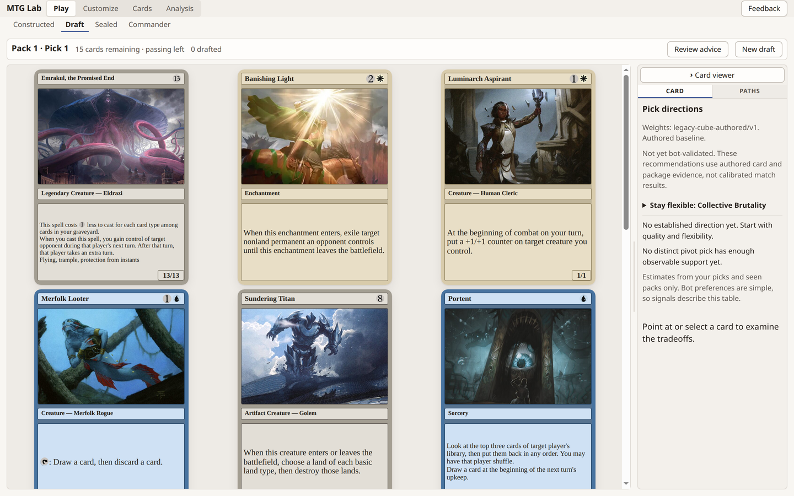
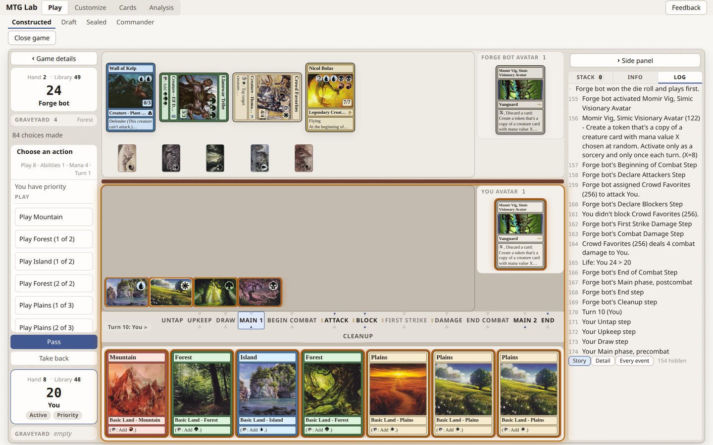
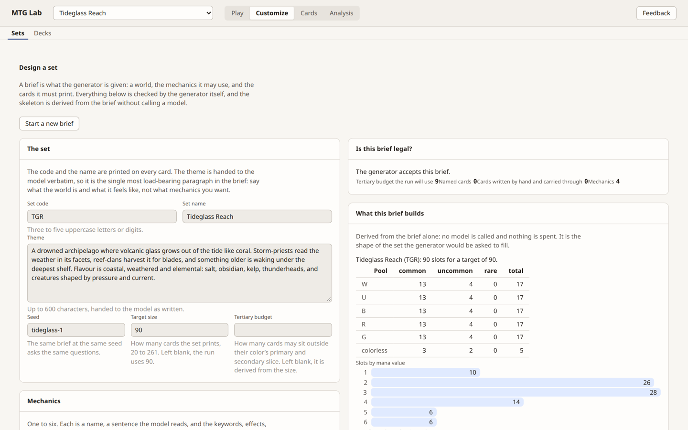
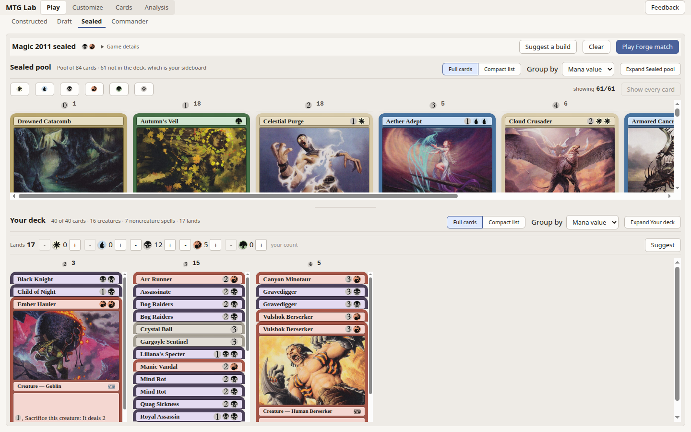

# MTG Lab

Play Magic: The Gathering against bots in your browser, and design your own sets.

> **Work in progress.** This is a research project published as it develops.
> Things change often and some parts are rough. The "Known gaps" section below
> lists what doesn't work yet.


## Quick start

You need Node 22 or newer and npm.

```bash
git clone https://github.com/sjarmak/mtg.git
cd mtg
npm ci
npm run play        # then open http://localhost:5273
```

That's enough to:

- **Play Tideglass Reach**, the example set, against a bot: sealed, draft or a
  precon game. It runs on this repo's own rules engine, with no API key, Forge
  or network needed.
- **Browse, draft and build with about 30 printed formats**, from Magic 2010
  through Ixalan plus Ravnica, Lorwyn and the MTGO Legacy Cube. Card art loads
  from Scryfall on demand, so you don't need to download anything.
- **Design a set** under Customize. `npm run design` starts the same page with
  the set designer's checker behind it.

## Playing printed formats against Forge

Matches with real Magic cards (Constructed precons, Commander, Momir Basic,
draft and sealed pods) run in [Forge](https://github.com/Card-Forge/forge) as
a separate process. You need a JDK 21 and, on Linux, Xvfb. Then:

```bash
npm run forge:install   # downloads Forge 2.0.14 (about 300 MB) and checks it
npm run play
```

Pick a format under _Magic printed formats_, or use the Draft and Commander
tabs, and press _Play Forge match_. The first launch takes a few minutes while
the lab checks each format against the installed Forge.

## What it looks like



_Legacy Cube draft: eight seats, bots on the other seven, with pick advice
on the right._


_The deck you drafted, played against Forge's AI._


_Commander with the official precons. The picker shows each deck's win rate
from human games and from the lab's own bot-vs-bot runs, so you can pick a
fair matchup._



_Momir Basic: decks are all basic lands, and you discard a card and pay X to
make a random creature with mana value X._



_The set designer: write a brief (world, mechanics, size) and see the set's
skeleton before any model is called._


_Card gallery for a printed format, filterable by color, type, rarity and mana
value._



_Sealed: open a pool and get a suggested 40-card build to edit._

## Making your own set

A set starts from a brief: a short JSON file with the world, up to six
mechanics and the size. The example is
`packages/setgen/briefs/tideglass-reach.json`.

```bash
# Rebuild Tideglass Reach from recorded model answers (no API key, no cost)
npx tsx packages/setgen/src/cli.ts \
  --brief packages/setgen/briefs/tideglass-reach.json --out out/set
```

The generator can only write cards in a typed rules language that the engine
runs, so every card it prints is playable. Cards the engine can't represent
are refused rather than approximated. To generate a new set with a live model,
see `packages/setgen` and `packages/llm`.

Tideglass Reach ships without card art on purpose. It's there to show what a
custom set looks like, so its cards show an "art pending" frame.

To check a set's balance:

```bash
npm run slice         # generate, build decks, simulate thousands of games, report
npm run test:balance  # the seeded 10,035-game balance gate
```

## Known gaps

- Momir Basic needs the local card store, built with `@mtg/data` from Scryfall
  bulk data. Without it the format is hidden.
- With Forge installed, the first launch is slow, a few minutes, while it
  checks each printed format.
- Printed-format matches are one-on-one against Forge's AI. Commander is
  played one-on-one too, not as a four-player pod.
- The clone is large (about 110 MB of history plus card catalogs).
- Phone layouts exist for the game table. The other pages are mainly built for
  desktop.

## How it's built

TypeScript throughout, no build step in development.

| Package                                  | What it does                                                    |
| ---------------------------------------- | --------------------------------------------------------------- |
| `dsl`                                    | The typed rules language cards are written in                   |
| `kernel`                                 | The rules engine: stack, priority, combat, layers, replacements |
| `deckbuild`, `sim`, `metrics`            | Deck building, bots, mass simulation and balance checks         |
| `llm`, `design-data`, `setgen`           | The set generator and its color pie and skeleton                |
| `data`, `decklab`, `cube`, `image-cache` | Real card data from Scryfall and MTGJSON                        |
| `forge-export`, `draft-export`           | The Forge bridge, and Draftmancer export                        |
| `ui`, `card-render`                      | The browser app and card faces                                  |
| `slice`, `referee`                       | The end-to-end pipeline                                         |

Checks:

```bash
npm run typecheck
npm test
npm run lint
npm run format
```

`AGENTS.md` has the coding conventions. Read it before sending changes.

## License

The code is AGPL-3.0-or-later. The few files derived from Forge stay
GPL-3.0; `LICENSE` lists them. Forge itself is downloaded separately and runs
as its own process. Attribution for card data and other sources is in
`NOTICE`, and npm dependencies are in `THIRD-PARTY-NOTICES.md`.

Portions of the materials used are property of Wizards of the Coast. ©Wizards of the Coast LLC.

MTG Lab is unofficial Fan Content permitted under the Fan Content Policy. Not approved/endorsed by Wizards.

Card metadata and images come from Scryfall, which doesn't own the artwork.
